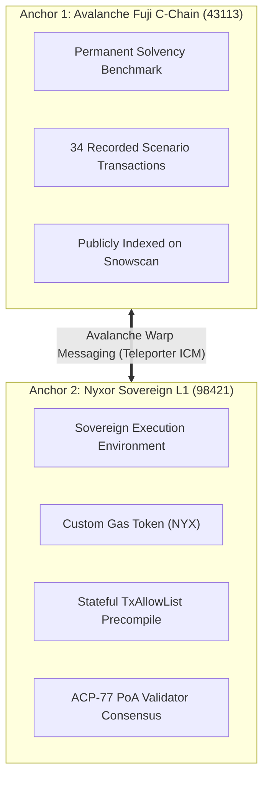

## The Two Anchors

To achieve institutional adoption without sacrificing decentralized auditability, Nyxor deploys across two Avalanche venues:

---

## Anchor 1: Permanent Solvency Benchmark (Fuji C-Chain)
* **Venue:** Avalanche Fuji C-Chain (`Chain ID: 43113`)
* **Role:** Immutable audit trail. 
* **Purpose:** Evaluators and auditors can verify that under identical market conditions, the Standard market accumulates **$7,487.26 USDx in bad debt**, whereas the Nyxor Guarded market records **$0.00 in bad debt**.
* **Explorer:** [Snowscan Testnet](https://testnet.snowscan.xyz)

---

## Anchor 2: Sovereign Institutional Layer (Nyxor L1)
* **Venue:** Nyxor Subnet-EVM Layer 1 (`Chain ID: 98421`)
* **Role:** High-throughput, permissioned execution.
* **Key Features:**
  1. **Custom Gas Token:** Transactions are paid in `NYX`, shielding traders from C-Chain gas spikes during volatile market opens.
  2. **Consensus Precompiles:** Employs the `TxAllowList` precompile (`0x0200...0002`) to enforce institutional access at the node mempool boundary.
  3. **Warp Interoperability:** Uses Avalanche Warp Messaging (AWM) and Teleporter to bridge collateral from the C-Chain without centralized bridges.
* **Explorer:** [Avalanche Builder Hub Glacier Explorer](https://build.avax.network/explorer/mainnet/2rbFkegM5CZH4zSCXmSF5kLe9JEWwDbLipkU1Sfb1gy1ZFLjUS/block/1)
