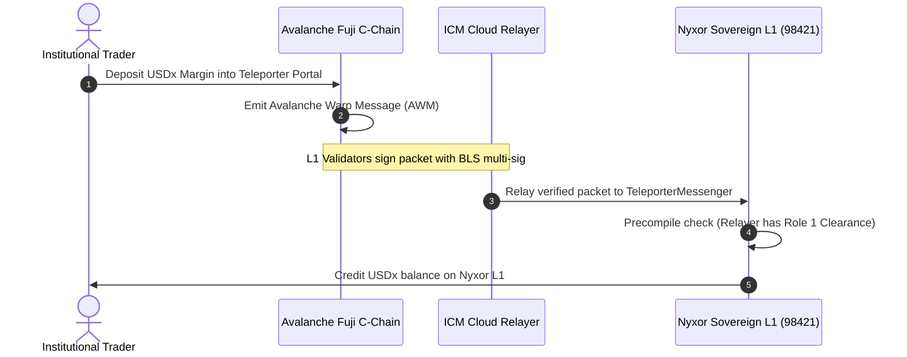

## Trustless Cross-Chain Liquidity

Traditional bridges rely on multi-sig committees or wrapped token custodians that represent single points of failure. 

Nyxor uses **Avalanche Interchain Messaging (ICM)** and **Teleporter**, where messages are validated directly by the consensus layer using aggregated BLS validator signatures under **ACP-77**.

---

## Architectural Flow

---

## Verified On-Chain Milestone Transaction

A real cross-chain collateral lockbox transaction has been mined on **Nyxor L1**:

* **Block Number:** `20`
* **Transaction Hash:** [`0x7b1581184594132edff78faa1700b4b5fdbac49d3948f7d074937abe410de4f4`](https://build.avax.network/explorer/mainnet/2rbFkegM5CZH4zSCXmSF5kLe9JEWwDbLipkU1Sfb1gy1ZFLjUS/tx/0x7b1581184594132edff78faa1700b4b5fdbac49d3948f7d074937abe410de4f4)
* **Contract Interacted:** `DemoUSDC` (`0x802508DB190b1826c6fC4238B5172F344ba96811`)
* **Relayer Lockbox Address:** `0x40e8484138998f777Be39DB3Baa8Ba425D5a882F`
* **Amount:** `1,000.00 USDx`
* **Gas Used:** `34,456`
