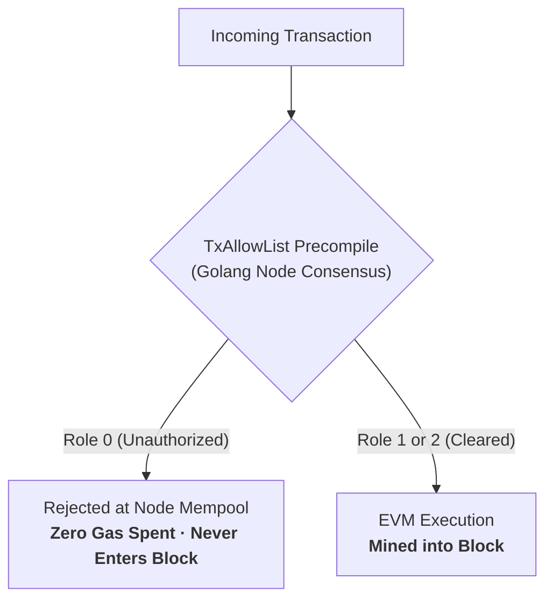

## What is `TxAllowList`?

On Nyxor L1, access control is not implemented inside Solidity application logic. Instead, it is enforced at the consensus mempool boundary by the stateful **`TxAllowList`** precompile at:

```text
0x0200000000000000000000000000000000000002
```

---

## Why Consensus Precompiles Over Smart Contract KYC?

Traditional EVM smart contract permissioning uses modifiers like `require(isWhitelisted[msg.sender])`. This introduces two severe vulnerabilities for institutional trading:



1. **Zero Wasted Gas on Reverts:** When an unauthorized entity attempts to submit a transaction, the node drops the packet immediately. No block space is consumed, and no gas is charged.
2. **Mempool Denial-of-Service Defense:** Non-whitelisted bots cannot spam the mempool to delay or frontrun institutional keeper liquidations.
3. **Regulatory Isolation:** Provides institutional partners with proof that un-KYC'd addresses cannot broadcast to the execution layer.

---

## Precompile Roles

The precompile assigns an integer role to each 20-byte address:

| Role Value | Designation | Capabilities |
|---|---|---|
| **`Role 0`** | `None` / Restricted | Transactions rejected immediately at the node boundary. |
| **`Role 1`** | `Enabled` / Transactor | Cleared to broadcast transactions, trade perps, and transfer tokens. |
| **`Role 2`** | `Admin` | Authority to call `setEnabled()`, `setAdmin()`, and `setNone()`. |

### Solidity Interface

```solidity
interface ITxAllowList {
    function readAllowList(address addr) external view returns (uint256 role);
    function setEnabled(address addr) external;
    function setAdmin(address addr) external;
    function setNone(address addr) external;
}
```
